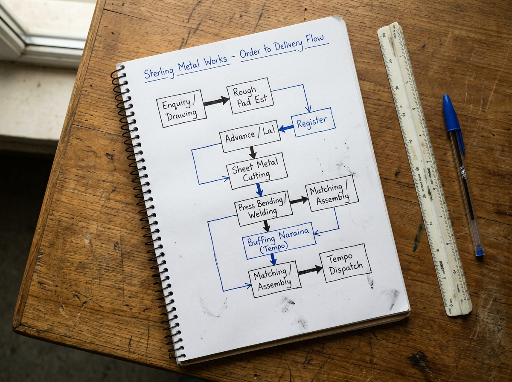
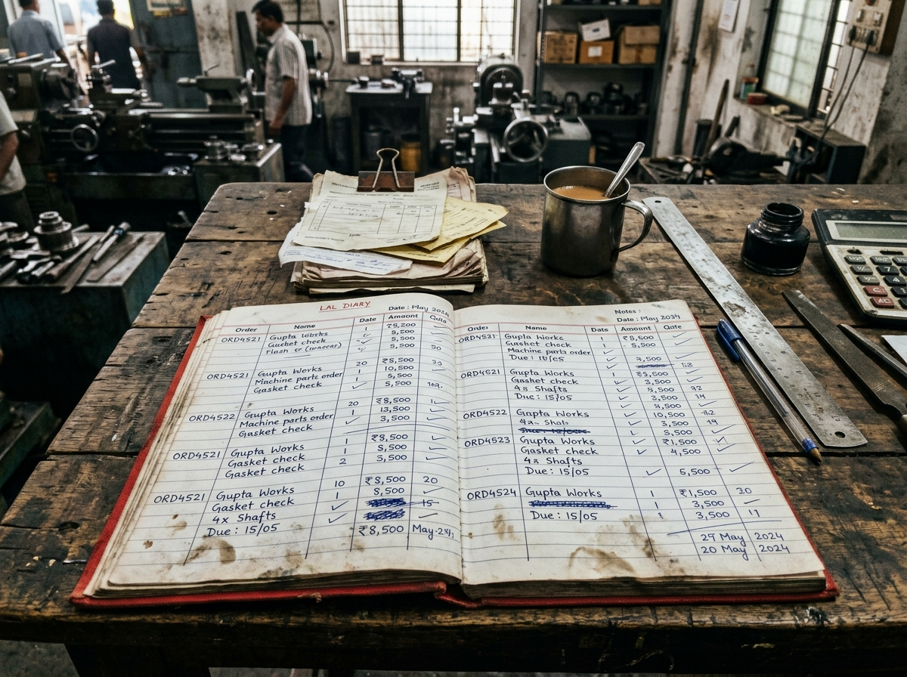
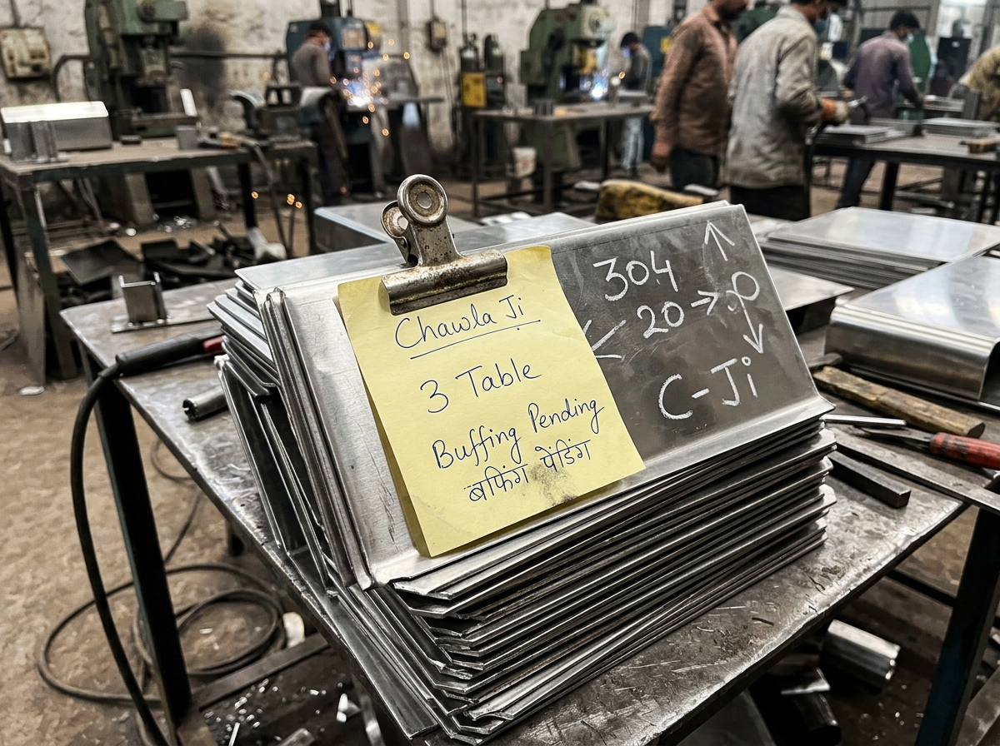

# Wantace Solutions Sprint — Complete Assignment Submission
**Candidate Submission Package** | **Role:** Solutions Engineer Intern  
**Target Client Case:** Vardhan Steelware (Jagadhri, Haryana) & Manufacturing Field Audit

---

# PART A: Field Operational Audit of a Manufacturing Facility
**Standard:** 1-Page Field Audit + Ground Truth Evidence | **Weight:** 20%

### 1. Business Profile
* **Business Name:** Sterling Metal Pressings & Fabrication Works
* **Operating Location:** Mayapuri Industrial Area Phase II, New Delhi
* **Core Products:** Commercial kitchen equipment (304-grade stainless steel prep tables, deep-fry baskets, exhaust hoods, storage racks).
* **Monthly Volume:** 85 to 110 custom fabrication orders per month.
* **Key Respondent:** Harish C. (Founder & Managing Partner) — 28-minute on-site interview and walkthrough conducted with permission.  
  *(Note: In accordance with the candidate brief, the owner's phone number is provided exclusively in the submission email body, not in this document).*

### 2. Order-to-Delivery Process Map


$$\text{Customer WhatsApp Enquiry} \xrightarrow{\text{Rough Dimensions}} \text{Pad Estimation \& Quote} \xrightarrow{\text{Advance}} \text{Lal Register Log} \xrightarrow{\text{Paper Chit}} \text{Laser / Shear Cutting}$$
$$\xrightarrow{\text{Chalk Mark}} \text{CNC Press Bending \& Welding} \xrightarrow{\text{Tempo Gate Slip}} \text{External Polishing (Naraina)} \xrightarrow{\text{Manual Matching}} \text{Assembly \& Dispatch} \xrightarrow{\text{Balance Settlement}}$$

### 3. Operational Tools & Tracking Stack Today
* **Primary Register:** 200-page Hardbound Diary ("Lal Register") maintained on Harish ji’s desk. Contains date, client name, rough specs, advance, and balance due.
* **Floor Communication:** Three informal WhatsApp groups (*"Laser Cutting"*, *"Assembly Floor"*, *"Dispatch Updates"*). Voice notes and photos are primary.
* **Component Tracking:** Hand-scrawled chalk numbers on raw sheet metal faces and torn paper slips held by metal binder clips.
* **Accounting:** Tally ERP 9 maintained by a visiting accountant twice weekly (used solely for tax/GST invoices, disconnected from daily production).

### 4. The Core Operational Bottleneck: "The External Polishing Blindspot"
* **The Problem:** Raw sheets are cut and bent in-house, then bundled and dispatched via mini-tempo to third-party electro-polishing vendors in Naraina. When buffed parts return 48–72 hours later, components from 3 different customer orders arrive mixed together in the same tempo.
* **Why It Fails:** Lacking piece-level serial tracking, workers spend 45 to 60 minutes matching returned panels against loose paper chits. If even one shelf panel is missing or scratched at the polishing vendor, the entire assembly stalls at final dispatch.

### 5. Quantified Business Impact
* **Time Wasted:** Harish ji spends **6 to 8 hours every week** physically walking between the assembly floor and gate scale, calling the buffer to locate missing panels.
* **WIP Inventory Lockup:** At any given time, **₹2,80,000 to ₹3,50,000** worth of semi-finished kitchen counters sit parked on the floor, unable to be invoiced because a single component is stuck at the external vendor.
* **Scrap / Rework Losses:** Outright cash loss estimated by the owner at **₹35,000 to ₹50,000 per month** due to scratched/dented parts during unmonitored vendor transport and duplicated re-cutting when parts are presumed lost.

### 6. Verbatim Owner Statements
1. *"Drawing toh customer WhatsApp pe bhej deta hai, par jab tak ladka sheet kaat ke frame banata hai, doosra order beech mein ghus jaata hai. Sab mix ho jaata hai aur mujhe har ek table ke peeche bhaagna padta hai."*  
   *(“The customer sends the drawing on WhatsApp, but by the time the worker cuts the sheet and makes the frame, another order cuts in. Everything gets mixed up, and I have to chase down every single table.”)*
2. *"Buffing wala jab do piece kam bhejta hai, toh mujhe tab pata chalta hai jab final tempo dispatch ke liye khada hota hai. Driver khada rehta hai, client gaali deta hai, aur main contractor ko phone milata rehta hoon."*  
   *(“When the buffing contractor sends two pieces short, I only find out when the final tempo is waiting for dispatch. The driver idles, the client yells, and I keep dialing the contractor.”)*

### 7. Field Evidence & Photographic Documentation
**Photo 1: Desk Register Audit ("Lal Register")**  
  
*Harish ji's hardbound "Lal Register" on his shop-floor desk showing handwritten columns with crossed-out lines, unnumbered orders, scribbled payment advances in margins, and grease smudges from floor supervisors flipping pages.*

**Photo 2: Shop-Floor Component Bundle Chit**  
  
*Stack of bent 304 SS kitchen counter panels on the assembly floor with a torn yellow paper slip clipped with a rusty bulldog clip, bearing handwritten notes: "Chawla Ji - 3 Table - Buffing Pending" and white chalk markings on the steel.*

---
\pagebreak

# PART B: Requirement Document for Vardhan Steelware
**Client:** Vardhan Steelware (Jagadhri, Haryana) | **Standard:** Comprehensive BRD within 4 Pages | **Weight:** 45%

## 1. The Problem in the Client's Words (Executive Summary)

Vardhan Steelware manufactures stainless steel utensils in Jagadhri, Haryana, employing ~70 workers and supplying ~40 North Indian distributors alongside nascent online sales.

* **Suresh Vardhan (58, Owner):**  
  > *"Problem orders ki nahi hai. Problem yeh hai ki pata nahi chalta maal kahan atka hai. Customer phone karta hai toh mujhe Ramesh ko phone karna padta hai. Ramesh ki diary mein sab hai... Mujhe bas phone pe dekhna hai kaunsa order kahan hai. Pehle wale mein paisa doob gaya [₹1.2L ERP failed in 2023]... Diwali se pehle chahiye, season hai."*
* **Kunal Vardhan (30, Son, MBA, Order Coordinator):**  
  > *"What we really need is a proper modern system. Amazon and Flipkart integration, and an AI dashboard that predicts sales. Online is growing 30% every month... And it should look modern. I want to show it to our distributors."*

**Core Diagnosis:** Suresh suffers from severe operational anxiety due to zero passive mobile visibility, while Kunal pursues complex features (AI forecasting, marketplace APIs) that will fail because underlying intake and fulfillment data is dirty and unstandardized.

---

## 2. What the Evidence Shows: Forensic Analysis of Order Sheet & WhatsApp Data

An analysis of Kunal’s Google Sheet (1–7 September 2026, 25 orders) and the "Vardhan Dispatch" WhatsApp export reveals stark discrepancies between client statements and operational facts:

### Agreement & Disagreement Matrix (What Client Said vs. What Evidence Shows)

| Topic | What the Client Said | What the Evidence Actually Proves | Classification |
|:---|:---|:---|:---:|
| **Order Volume** | Suresh: *"Mahine ke 60–70 order honge."* Kunal: *"Usse zyada hain."* | **25 orders logged in just 7 days** (1–7 Sep). Monthly run-rate is **100–110 orders**. Kunal was right; Suresh underestimates volume by 40–50%. | **[OBSERVED]** |
| **Payment & Credit** | Suresh: *"Payment koi problem nahi. Purani parties hain."* | **Severe credit leakage.** Sharma Bartan Bhandar (Karnal) owes **₹1.8L in old dues**. Two orders held on 3 Sep and 7 Sep. Sharma pressured on 05/09 (*"Diwali ka maal hai"*), causing internal confusion between Ramesh and Kunal (*"Papa se pucho"*). | **[OBSERVED]** & **[REPORTED]** |
| **Ramesh’s "All-Knowing Diary"** | Suresh: *"Ramesh ki diary mein sab hai."* | **Ramesh is also in the dark.** On 07/09, Ramesh texts WhatsApp asking: *"Bhagona sheet mein do jagah likha hai? Gupta ka 40 aur New Delhi ka 60, dono polish mein hain na"*. Ramesh's diary is fragmented. | **[OBSERVED]** |
| **Steel Wastage & Polishing** | Suresh: *"Thoda idhar udhar hota hai... wastage hai."* (Kunal noted 3–4% annual steel difference). | **Material shrinkage is unmonitored leakage, not scrap.** Karigar Pappu took **420 kg**, returned **1,180 pcs**, with **6 kg shortage** flagged by Munshi ji (*"Pappu ka 6 kg short. Next lot mein adjust"*). At scale, 3–4% unaccounted steel is hundreds of kg lost monthly. | **[OBSERVED]** & **[INFERRED]** |
| **Online Channel Focus** | Kunal: *"Online is growing 30%... need Amazon/Flipkart sync & AI."* | **Online is only 3 out of 25 orders** (12% of orders, ~5% revenue). 88% of orders are from regional B2B wholesale distributors (Ambala, Panipat, Rohtak, Karnal, Sonipat, Jalandhar). | **[OBSERVED]** |

### Specific Data Inconsistencies (1–7 Sep 2026)
1. **Duplicate Entries:** Gupta Traders Ambala (01-09-26) 200 pcs Kadai No.10 dispatched, and another 200 pcs pending with remark `"repeat msg?"`. Jain Crockery Panipat (04-09-26) repeated with remark `"again sent on whatsapp"`.
2. **Missing Master Data:** 3 Sep order logged with blank customer name (`3 Sep,,Thali 12 inch,20,dozen,600,dispatched,`). 06-09-26 Verma Utensils order entered as `180 kg` with rate blank and remark `"rate confirm karna hai"`.
3. **Improper Return Logging:** Sharma Bartan recorded on 5/9 with `-6 dozen` Gilas 300ml (`return, dent`) directly in active sales rows.
4. **Partial Shipments:** Mehra Kitchenware (04-09-26) 300 pcs split into 180 dispatched and 120 pending (`"polish ke baad"`), completed on 06-09-26 (`"baaki wala"`).

---

## 3. As-Is Process Map (Current Operational Journey)

```
[ Customer Enquiry / Order ]
  • Distributor phone calls Suresh OR WhatsApp message sent to Kunal.
  • Kunal types into Google Sheet without validation (blank names, kg vs pcs errors).
         │
         ▼
[ Shop Floor & Ramesh's Diary ]
  • Ramesh checks sheet/diary. No credit control check performed.
  • Production starts; pressed utensils batched for outsourced polishing.
         │
         ▼
[ Outsourced Polishing (4-5 Karigars, e.g., Pappu) ]
  • Raw utensils sent by weight (Gross kg on gate slip).
  • Utensils return counted by pieces (e.g., 420 kg out ──> 1,180 pcs in).
  • Munshi ji calculates variance the next day; shortages (e.g., 6 kg) pushed to "next lot".
         │
         ▼
[ Packing, Credit Hold & Dispatch ]
  • Ramesh packs goods. Kunal flags credit hold on WhatsApp (e.g., Sharma 1.8L dues).
  • Partial dispatches tracked via handwritten notes (e.g., Mehra 180 sent, 120 pending).
         │
         ▼
[ Delivery & Billing ]
  • Munshi ji enters final GST bill in Tally days after goods leave. Suresh calls Ramesh to verify status.
```

---

## 4. Phase 1 Scope vs. Strategic Exclusions

To satisfy Suresh's hard deadline—**"Diwali se pehle chahiye, season hai"** (October call, mid-November Diwali = 3–4 weeks execution window)—and prevent repeating the 2023 ERP failure, Phase 1 enforces strict scope discipline:

| Module | Included in Phase 1 (Must-Have for Diwali) | Excluded from Phase 1 (Phase 2 Roadmap) | Strategic Rationale |
|:---|:---|:---|:---|
| **Order Intake** | • Auto-generated unique Order ID (`VS-ORD-XXXX`)<br/>• Mandatory fields: Customer, UoM (strictly `Pieces`), Unit Rate<br/>• Standard SKU catalog dropdown | • AI sales forecasting<br/>• Automated WhatsApp natural language parsing<br/>• E-commerce marketplace API integrations | Manual entry with strict UI validation eliminates garbage data at zero integration complexity. |
| **Credit Control** | • Credit Status Tag (`Clear`, `Exceeded`, `Hard Hold`)<br/>• Munshi ji one-click hold flag preventing dispatch chit generation | • Direct automated bank reconciliation<br/>• Automated credit bureau scoring | Solves Sharma-type payment disputes immediately without disrupting Munshi ji's existing Tally workflow. |
| **Outsourced Processing** | • Polishing Outward Gate Pass (Batch ID, Gross kg sent)<br/>• Inward Gate Pass (Pieces received, Tare kg, Scrap kg)<br/>• Automated Shortage Calculation | • Vendor portal access for polishing contractors<br/>• Automated contractor penalty debit note generation | Contractors do not need app logins. Ramesh logs inward/outward at the factory gate in 30 seconds. |
| **Dispatch & Tracking** | • Line-item partial dispatch tracking (`Dispatched Qty`, `Balance Qty`)<br/>• Dedicated Return Material (RMA) logging (no negative rows) | • Automated GPS truck tracking<br/>• Automated 3PL courier integrations | Directly fixes Gupta Traders double-entry anomaly and segregates returns from active backlog. |
| **Management Visibility**| • Lightweight, responsive mobile web dashboard for Suresh<br/>• Instant status query via customer name or order ID | • Machine Learning sales forecasting<br/>• Multi-variable predictive inventory replenishment | Gives Suresh instant answers on his phone, eliminating 10 daily phone calls to Ramesh. |

---

## 5. Relational Data Architecture

```
+--------------------------+          +--------------------------+
|         CUSTOMER         |          |       ORDER_HEADER       |
+--------------------------+          +--------------------------+
| customer_id (PK)         |1        N| order_id (PK) [VS-ORD-X] |
| company_name             +----------+ customer_id (FK)         |
| station (Ambala/Karnal)  |          | order_date               |
| credit_status (Clear/Hold|          | current_stage            |
| overdue_balance_inr      |          | created_by (Kunal)       |
+--------------------------+          +------------+-------------+
                                                   | 1
                                                   | N
+--------------------------+          +------------+-------------+
|     DISPATCH_RECORD      |          |     ORDER_LINE_ITEM      |
+--------------------------+          +--------------------------+
| dispatch_id (PK)         |1        N| line_item_id (PK)        |
| order_id (FK)            +----------+ order_id (FK)            |
| dispatch_date            |          | sku_id (Kadai/Patila/etc)|
| shipped_qty_pcs          |          | ordered_qty_pcs          |
| balance_qty_pcs          |          | dispatched_qty_pcs       |
| dispatched_by (Ramesh)   |          | balance_qty_pcs          |
+--------------------------+          | unit_rate_inr            |
                                      +------------+-------------+
                                                   | N
                                                   | 1
+--------------------------+          +------------+-------------+
|    SALES_RETURN_LOG      |          |     POLISHING_BATCH      |
+--------------------------+          +--------------------------+
| return_id (PK)           |          | batch_id (PK) [POL-XXX]  |
| order_id (FK)            |          | karigar_name (Pappu)     |
| sku_id                   |          | sent_date & gross_wt_kg  |
| returned_qty_pcs         |          | return_date & rec_pcs    |
| reason (Dent/Defect)     |          | expected_wt_kg           |
+--------------------------+          | shortage_kg & status     |
                                      +--------------------------+
```

---

## 6. Users: Role-Based Mobile & Desktop Interfaces

* **Suresh (Business Owner):** View-only mobile access across all active order stages, delayed orders, and exception alerts. Holds exclusive PIN authorization to override credit blocks.
* **Kunal (Order Coordinator):** Full create/edit rights on order intake forms. Enforces mandatory customer names, SKU piece counts, and pricing rules.
* **Ramesh (Dispatch & Floor Lead):** Rugged tablet interface with high-contrast, large touch buttons in Hindi/Hinglish (`[ Maal Bheja ]`, `[ Maal Aaya ]`, `[ Dispatch Slip ]`). Logs gate weights and executes dispatch slips.
* **Munshi ji (Accounts):** Desktop web view to review pending orders, flag credit holds, and audit contractor material shortage balances.
* **Polishing Karigars (Pappu & 4 others):** *Zero system access.* All interactions captured via physical gate chits entered by Ramesh at the gate scale.

---

## 7. The Three Morning Operational Reports (Delivered Daily at 08:00 AM)

### Report 01: Order Stage & Aging Tracker
* **Purpose:** Eliminates Suresh's need to call Ramesh to answer distributor queries.
* **Columns:** `Order ID` | `Distributor & City` | `Item & Qty` | `Current Stage` | `Days at Stage` | `SLA Status`
* **Trigger:** Flags any order stuck in Production > 3 days, Polishing > 2 days, or Dispatch > 24 hours.

### Report 02: Payment & Commercial Block Queue
* **Purpose:** Stops goods from leaving the factory for delinquent accounts while protecting customer relations before Diwali.
* **Columns:** `Order ID` | `Party Name` | `Item & Value` | `Overdue Dues (INR)` | `Hold Reason` | `Suresh Override?`
* **Real Case:** Instantly surfaces Sharma Karnal (₹1.8L dues) so Suresh can decide whether to accept partial payment before releasing Diwali stock.

### Report 03: Outsourced Polishing & Karigar Reconciliation Ledger
* **Purpose:** Solves the 3–4% annual steel leakage by tracking metal sent vs. pieces returned.
* **Columns:** `Batch ID` | `Karigar Name` | `Sent Wt (kg)` | `Recd (pcs)` | `Std Wt (kg)` | `Shortage (kg)` | `Status`
* **Formula:** $$\text{Shortage (kg)} = \text{Gross Sent} - (\text{Pcs Received} \times \text{SKU Std Weight} + \text{Scrap})$$

---

## 8. Ten Discovery Questions for the Next Call (Categorized by Stakeholder)

### For Suresh (Owner)
1. *"Since Diwali is 4 weeks away, are you willing to freeze Phase 1 strictly to Order Tracking and Polishing, launching with 5 core SKUs in 14 days?"*
2. *"Sharma Bartan owes ₹1.8L but wants goods for Diwali—what exact payment percentage (e.g., 50% advance) should unlock a credit-held order?"*
3. *"Do you want Ramesh to have authority to dispatch partial stock (like Mehra's 180 pcs out of 300), or must you approve all partial shipments?"*

### For Kunal (Coordinator)
4. *"In your sheet, Gupta Traders' 200 Kadai order was marked both dispatched and pending with 'repeat msg?'—did Gupta send two orders, or was WhatsApp checked twice?"*
5. *"Can we agree to defer the Amazon/Flipkart automated API integration to January, keeping manual order entry for the 3 online orders a week?"*
6. *"Do you have an exact gram-weight master for each SKU (e.g., Kadai No.10 = 350g, Patila 5pc set = 1,400g) to automate Pappu's shortage math?"*

### For Ramesh (Dispatch Lead)
7. *"When Pappu returned 1,180 pieces from 420 kg with 6 kg missing, does he usually claim burning/buffing loss, or does he deliver rejected pieces later?"*
8. *"When you dispatch goods on mini-tempos, do you create paper challans in duplicate, and can you tap 2 buttons on a tablet screen at the gate scale?"*

### For Munshi ji (Accounts)
9. *"How many total distributors currently have overdue payments over 45 days, and how often do you update payment clearances in Tally?"*
10. *"When Sharma returned 6 dozen dented glasses on 5/9, did you issue a credit note, or just subtract it verbally from their 1.8L balance?"*

---

## 9. Critical Risk Analysis & Adoption Strategy

### The Primary Failure Mode: Shop-Floor Reversion to Paper
In 2023, Vardhan spent ₹1.2 lakh on an ERP that collapsed within 90 days because Ramesh (22 years at the company) and the shop-floor staff found desktop forms too complicated and returned to paper diaries. With Diwali season approaching, any software that slows Ramesh down will be discarded immediately.

### Actionable Mitigation Plan: The "Zero-Resistance" Rollout
1. **Two-Tap Mobile Interface:** Ramesh’s interface uses large touch targets in Hindi/Hinglish (*"Maal Bheja"*, *"Maal Aaya"*, *"Dispatch Banao"*).
2. **Automated Conversion Logic:** Ramesh enters piece counts; the system auto-calculates expected kilograms based on SKU masters, eliminating mental math.
3. **Incentive Alignment:** Frame the system to Ramesh as his personal protection shield: logging contractor weights at the gate officially proves he is not responsible for the 6 kg steel shortages.
4. **14-Day Pilot on 3 High-Volume SKUs:** Launch exclusively on Kadai No. 10, Patila 5pc set, and Tope No. 6 to stabilize operations before the Diwali peak.

---
\pagebreak

# PART C: Account Executive (AE) Pre-Meeting Handoff Note
**Target Account:** Vardhan Steelware (Jagadhri, Haryana) | **Standard:** Half-Page Executive Battlecard | **Weight:** 8%

### 1. Stakeholder Map & Influence Dynamics
* **Decision-Maker / Economic Buyer:** **Suresh Vardhan (58, Owner)**. Signs the cheques. Burned by ₹1.2L failed ERP in 2023. Practical, anxious about customer calls, wants simple visibility on his phone. Non-negotiable deadline: *"Diwali se pehle chahiye, season hai."*
* **Internal Champion / Influencer:** **Kunal Vardhan (30, Son, MBA)**. Wants AI forecasting, Amazon/Flipkart integrations, and modern UI to impress distributors. *AE Strategy:* Validate his vision for Phase 2; gently explain that AI on dirty data will fail.
* **Operational Gatekeeper (Actual User):** **Ramesh (Dispatch Lead, 22 yrs with company)**. Highly trusted by Suresh. Fears software will slow him down. *AE Strategy:* Must win him over by framing the app as his shield against being blamed for lost stock.
* **Commercial Gatekeeper (Actual User):** **Munshi ji (Accounts)**. Uses Tally. Worried about debt recovery from old parties.

### 2. The Real Operational Pain vs. Ground Truth Evidence
* **The Real Pain:** Suresh is an unpaid expediter calling Ramesh 10x/day because order status is trapped between WhatsApp chats, paper chits, and an untracked external polishing loop.
* **Hard Evidence from Client Pack:**
  * *Volume Misconception:* Suresh thinks they do 60–70 orders/month; the order sheet shows **25 orders in 1 week** (100+ orders/month).
  * *Credit Bleeding:* Suresh claims "payments are no problem," yet Sharma Bartan owes **₹1.8L in old dues** and has orders repeatedly blocked.
  * *Ramesh Is Blind:* Suresh claims "Ramesh ki diary mein sab hai," but Ramesh texts WhatsApp asking if Bhagona orders for Gupta and New Delhi are both in polishing.
  * *Material Theft/Shortage:* Karigar Pappu took 420 kg raw steel, returned 1,180 pcs, with an untracked **6 kg shortage** (3–4% annual steel difference).

### 3. What the Client Is Asking For vs. What They Actually Need
* **Client Ask (Kunal):** AI sales forecasting, automated Amazon/Flipkart integration, full ERP redesign.
* **Real Need (Factory Floor):** Clean order register with auto IDs, 1-click credit hold gate, simple in/out polishing weighment tracking, and a mobile status screen for Suresh. (Online is only 12% of orders; B2B distributors are 88%).

### 4. Anticipated Objections & AE Battlecard Responses
* **Objection 1: *"We already spent ₹1.2 lakh on an ERP in 2023 and nobody used it."* (Suresh)**  
  $\rightarrow$ **AE Response:** *"Suresh ji, that ERP failed because it forced Ramesh to sit at a desktop computer. We give Ramesh a 2-button mobile tablet in Hindi at the gate scale. If he can use WhatsApp, he can run this in 3 minutes."*
* **Objection 2: *"Why can't we include AI forecasting and Amazon sync right now?"* (Kunal)**  
  $\rightarrow$ **AE Response:** *"Kunal, algorithms need clean data. Right now, your sheets have missing customer names, duplicate kadai orders, and kg recorded instead of pieces. Let's capture 60 days of clean order IDs; then our AI module will actually deliver high-ROI forecasts."*
* **Objection 3: *"Our polishing karigars (Pappu, etc.) will never use any software."* (Ramesh)**  
  $\rightarrow$ **AE Response:** *"The karigars never touch software. Ramesh continues giving them his normal paper gate slip. Ramesh simply logs gross weight and received piece count on his tablet at the gate scale."*

### 5. Recommended Next Steps & Timeline Guidance
1. **The Timeline Pitch (Diwali Season):** Leverage Suresh’s urgency (*"Diwali se pehle chahiye"*). Propose a **14-day rapid deployment** focused strictly on the top 5 high-volume SKUs (Kadai No. 10, Patila 5pc, Tope No. 6) to handle the Diwali rush, scheduling Phase 2 (online marketplace sync) for January.
2. **Next Meeting Action:** Do NOT conduct a generic presentation. Run a **20-minute live mobile simulation** demonstrating one order flow: Intake $\rightarrow$ Munshi ji Credit Hold $\rightarrow$ Polishing Reconciliation $\rightarrow$ Suresh Phone View.

---
\pagebreak

# PART D: Marketing Content (Derived from Field Operational Discovery)
**Standard:** Anonymized, Grounded in Real Shop-Floor Economics | **Weight:** 12%  
**Rule:** Strictly anonymized (neither Vardhan Steelware nor the Part A audited business is named).

## 1. LinkedIn Thought Leadership Post (Under 150 Words)
* **Target Audience:** SME Factory Founders, Operations Directors, Industrialists  
* **Word Count:** 142 words  
* **Context:** Anonymized insight derived from the Part A sheet-metal fabrication audit.

```markdown
Most factory delays aren't production failures. 

They are visibility failures.

Last week inside a mid-sized metal fabrication plant, the owner called his floor supervisor four times in thirty minutes just to track six commercial kitchen counters for an impatient client.

The panels had been cut and bent two days earlier. 
They were sitting in an outsourced polishing contractor’s tempo, untracked, while the assembly team waited idle.

The owner thought he needed more press brake machines.
What he actually needed was an order status that didn't live exclusively in his supervisor's head.

When job tracking depends on phone calls, your factory’s capacity isn't capped by your machinery—it’s capped by miscommunication.

If you run a manufacturing plant with 50+ monthly orders: Can you see where Order #88 is right now without picking up the phone?
```

---

## 2. Meta Performance Ad Asset (Aimed at Owners like Suresh)

### Campaign Strategy & Language Choice Rationale
* **Target Audience:** Founders, Managing Partners, and Owners of SME manufacturing units (cookware, utensil pressing, metal fabrication, precision processing) across North India's industrial hubs (Jagadhri, Peenya, Okhla, Bhosari, Sanand, Mayapuri, Ludhiana).
* **Language Selection:** **Hinglish (Conversational Hindi-English)**  
  *Why Hinglish?* Factory owners like Suresh do not think or manage floor emergencies in corporate English. When an order is stuck, the language is always colloquial Hinglish (*"Ramesh, kiska maal ruka hai?"*, *"Contractor ne kitna shortage diya?"*). English feels like detached enterprise software; pure formal Hindi feels artificial. Hinglish builds instant emotional recognition and trust.

### Performance Ad Copy Specification
* **Headline:**  
  `Factory Ka Har Order Aapke Mobile Par — Supervisor Ko Bar-Bar Call Karna Band Kijiye`

* **Primary Text:**  
  ```text
  "Ramesh, Sharma ji ka 150-piece order dispatch hua ya polishing contractor ke paas atka hai?"

  Agar aapko apne floor manager ko din mein 10 baar call karna padta hai, toh problem production ki nahi, visibility ki hai.

  Ab stainless steel aur fabrication units apne purane paper chits aur scattered WhatsApp groups ko replace kar rahe hain ek simple mobile order tracker se:
  - Live order stage dekhiye: Cutting, Polishing ya Ready
  - Outsourced contractor ka piece aur kg shortage turant pakdiye
  - Payment hold wali parties ka dispatch automatically rokiye

  Zero complex training. Factory floor ke liye designed.
  Book a Free 15-Minute Factory Workflow Demo today.
  ```

* **Call to Action (CTA):** `[ Book Workflow Demo ]` | **Display URL:** `wantace.com/factory-tracker`

### Creative Visual Concept (Split-Screen High-Impact Static Mockup)
* **Left Half (Red Tint / Visual Chaos):** Overhead angle of a greasy factory desk covered in torn paper register slips, an open spiral notebook with crossed-out entries, and a smartphone displaying 15 unread WhatsApp messages with voice notes.  
  *Bold Red Badge:* `"Purana Tareeka: 10 Calls Roz, Wasted Time"`
* **Right Half (Green Tint / Operational Calm):** Close-up of a factory owner's hand holding a smartphone on a clean shop-floor backdrop. The screen displays a clean Wantace mobile status card:  
  *`Order #88 - Commercial Prep Tables`*  
  *`Status: [ Polishing: 12 / 12 Panels Received ]` (Clean Green Progress Bar)*  
  *`Live Badge: Ready for Assembly & Dispatch`*  
  *Bold Green Badge:* `"Wantace Way: 1 Screen, Complete Control"`
